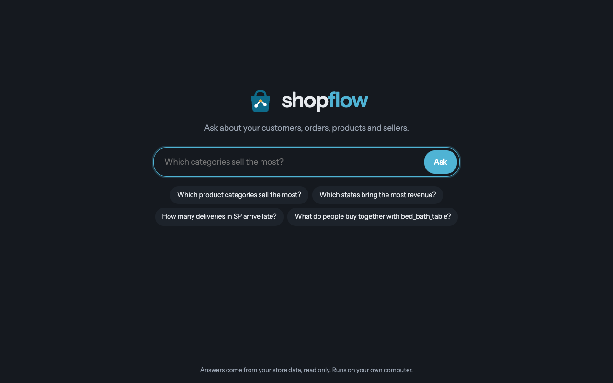

# ShopFlow Brain

An AI assistant that answers questions about a fictional online store's customers, orders,
products and sellers. It runs on a local LLM through Ollama and reads only the tested gold
tables built by the sister repo
[shopflow-platform](https://github.com/adegbenleb/shopflow-platform), plus a Neo4j graph of
orders. A personal learning project.



Part of my portfolio: **https://adegbenleb.github.io/portfolio/**

## How it works

```
question ──► FastAPI /api/ask ──► LangGraph agent (Ollama, llama3.1:8b)
                                        │  picks one of 7 curated tools
                         ┌──────────────┴──────────────┐
                         ▼                             ▼
            Postgres analytics_gold              Neo4j order graph
            (parameterised SQL)                  (read-only Cypher)
                         └──────────────┬──────────────┘
                                        ▼
                 answer + tools used ──► invented-tool guardrail ──► page
```

**Agent** (`agents/assistant.py`): a LangGraph tool-calling loop on a local Ollama model at
temperature 0. The system prompt tells it to always use a tool for numbers and never invent
tools. It can also run as a command-line REPL.

**Tools** (`agents/tools.py`): every tool is a fixed, parameterised query filtered by
`TENANT_ID`. Sort columns come from a whitelist, so the model never writes SQL. Limits are
clamped to 1 to 50, and customer and product IDs are shown truncated.

| Tool | Answers |
|---|---|
| `sales_by_category` | Top categories by revenue, with order counts |
| `list_categories` | The category names that exist |
| `top_products` | Best products by revenue or units, optionally in one category |
| `top_customers` | Best customers by spend, orders or items, optionally in one state |
| `customers_by_state` | Customers, orders, revenue and average review per state |
| `delivery_performance` | Average delivery days and share of late deliveries |
| `bought_together` | Categories bought in the same orders as a given category (Neo4j) |

**Guardrails**
- Curated read-only queries only: SQL values are bound parameters, Neo4j sessions are
  read-only.
- If the model's answer mentions a tool that does not exist, the answer is replaced with a
  fixed message that lists what the assistant can do.
- Questions must be 1 to 500 characters; agent failures return HTTP 503 with a clear message.

**Graph loader** (`knowledge/graph_loader.py`): copies the gold tables into Neo4j in batches
as `Customer`, `Order`, `Product`, `Category` and `Seller` nodes, linked by `PLACED`,
`CONTAINS`, `IN_CATEGORY` and `SOLD_BY`.

**API** (`api/main.py`): `GET /` serves the question page, `GET /api/health` returns
`{"status": "ok"}`, `POST /api/ask` takes `{"question": "..."}` and returns
`{"answer": "...", "tools_used": [...]}`.

## Run it locally

Needs Python 3.12 with [uv](https://docs.astral.sh/uv/), the
[shopflow-platform](https://github.com/adegbenleb/shopflow-platform) services running with
the gold tables built, and [Ollama](https://ollama.com/) on your machine. Everything stays
local.

```bash
# 1. Install and configure
uv sync
cp .env.example .env              # then set your passwords

# 2. Pull the local model
ollama pull llama3.1:8b

# 3. Load the order graph into Neo4j (once, and after the gold tables change)
uv run python -m knowledge.graph_loader

# 4. Ask questions in the browser at http://localhost:18500
uv run uvicorn api.main:app --port 18500 --reload

# or in the terminal
uv run python -m agents.assistant
```

## Tests

```bash
uv run ruff check . && uv run ruff format --check .
uv run pytest -q
```

The tests need no Ollama, Postgres or Neo4j: the agent is replaced with a fake. They cover
the API and the invented-tool guardrail. GitHub Actions runs lint and tests on every push to
main and on pull requests.

## Status

Working today: the agent with seven tools, the question page and API, the Neo4j graph loader
and the guardrail above. Planned and not built yet: document search with Qdrant, marketing
and finance tools, and an evaluation set.

## Stack

Python 3.12, LangGraph, LangChain Ollama, FastAPI, PostgreSQL (psycopg), Neo4j, pytest,
ruff, uv, GitHub Actions.
